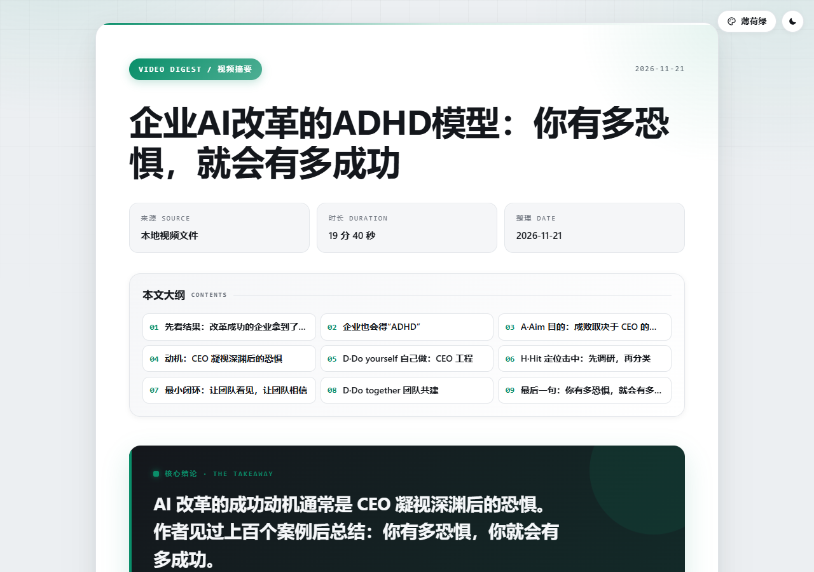
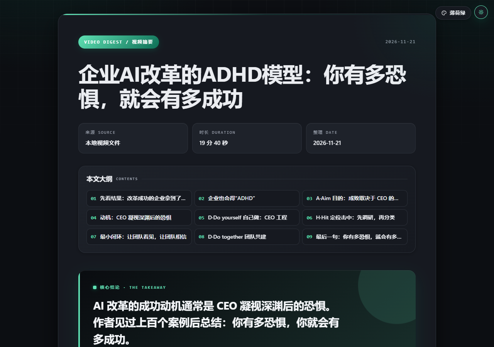
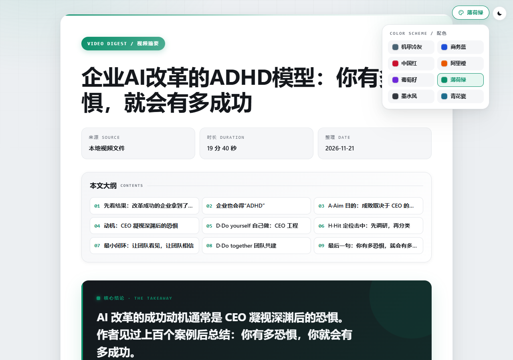
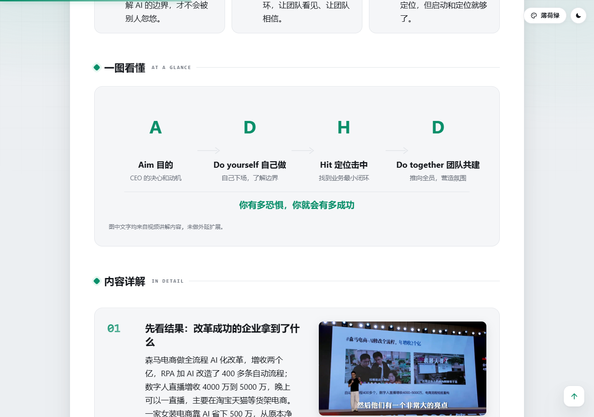
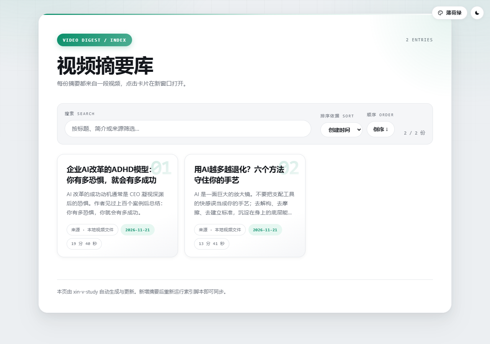

# xin-v-study

把一段讲解视频变成图文并茂的单页 HTML 摘要。

[English](README_EN.md) · Python 3.8+ · Agent Skill · 单文件自包含输出



---

## 它解决什么

看完一个讲解视频，想留下能快速回顾的东西——不是逐字稿，也不是读后感，而是一份"视频到底讲了什么"的图文摘要。这个 skill 把视频语音转录出来，去掉口语废话，按原意提炼成核心结论、要点和分段详解，再从视频里抽真实画面配图，最后产出一份断网也能打开的 HTML。

**底线是不失真**：视频没说的一个字不写，配图必须是视频里的真实画面。

## 特性

- **内容守真**：只做去噪和归纳，不补充背景、不联想、不替作者圆场。摘要篇幅压在原文 20%–35%。
- **真实配图**：均匀抽帧后逐张读画面，只保留和段落对得上的帧，图注带视频时间点。不生成示意图。
- **单文件成品**：CSS/JS 内嵌、图片走 base64，断网可完整打开，拷走一个文件就能看。
- **8 套配色 × 浅深主题**：机甲冷灰、商务蓝、中国红、阿里橙、葡萄籽、薄荷绿、墨水风、青花瓷。默认薄荷绿，右上角切换，两页共享记忆。
- **大纲导航**：摘要页顶部自动生成章节目录，点击跳转、滚动高亮当前章节；右下有回到顶部按钮，顶部有滚动进度条。
- **知识脑图**：从章节标题自动生成放射脑图，与正文一一对应，无需手工绘制；标题过长可用 `data-mind` 短标签精修。
- **卡片导航页**：每次生成后自动重建 `_list.html`，支持搜索、按时间/名称排序、新窗口打开。
- **输入兼容**：本地视频文件、媒体直链、B 站/YouTube 等平台网页地址。

## 安装

选一种适合你的方式。

### 方式一：命令行 / Skill 市场（推荐）

用 [`skills` CLI](https://github.com/vercel-labs/skills) 一行命令从仓库安装，支持 Claude Code、Cursor、Codex 等 40+ 工具：

```bash
npx skills add oscar-wang-xin/xin-v-study
```

全局安装（对所有项目生效）与目标工具指定：

```bash
npx skills add oscar-wang-xin/xin-v-study -g
npx skills add oscar-wang-xin/xin-v-study --agent claude-code
```

装之前先看仓库里有哪些技能、或跳过交互确认：

```bash
npx skills add oscar-wang-xin/xin-v-study --list
npx skills add oscar-wang-xin/xin-v-study -y
```

> 命令是 `npx skills`（复数）。也可写作完整地址 `npx skills add https://github.com/oscar-wang-xin/xin-v-study`。后续用 `npx skills update` 更新、`npx skills remove xin-v-study` 卸载。

### 方式二：下载 zip 直接导入

下载仓库根目录的 [`xin-v-study.zip`](xin-v-study.zip)，解压后把整个 `xin-v-study` 目录放进所用工具的 skills 目录即可。包里已含 `SKILL.md`、脚本、模板、规范和本文档，不含本机配置。

```bash
unzip xin-v-study.zip -d /path/to/your/skills/
# 或让支持 zip 导入的工具直接选择这个压缩包
```

WorkBuddy 里也可以放到 `~/.workbuddy/skills/`，新会话用 `@skill:xin-v-study` 调用。

### 方式三：git clone

```bash
git clone https://github.com/oscar-wang-xin/xin-v-study.git
cp -r xin-v-study ~/.workbuddy/skills/
```

想让实体留在原地、改文件即时生效，可以用软链：

```bash
ln -s /path/to/xin-v-study ~/.workbuddy/skills/xin-v-study
```

## 环境

- Python 3.8+
- 全部步骤都是普通 Python 命令行，**不依赖任何特定 Agent 工具**——WorkBuddy、Claude Code、Cursor、Codex 等只要能执行命令就能跑通
- 依赖由 `scripts/bootstrap.py` 自动安装：`imageio-ffmpeg`（抽帧/抽音频）、`yt-dlp`（在线下载）、`faster-whisper`（本地语音转录）
- 转录模型在首次使用时下载并缓存到本机（默认 `small` 约 470 MB），之后离线可用；国内下载慢可设 `HF_ENDPOINT=https://hf-mirror.com` 镜像

## 配置默认输出目录

复制示例配置并改成自己的路径：

```bash
cp config.example.json config.json
```

```json
{
  "default_output_dir": "/path/to/your/digests"
}
```

绝对路径和相对路径都行，相对路径按项目根目录解析。`config.json` 已在 `.gitignore` 里，不会进版本控制。

**默认值只在被选中时生效**：给视频时如果没有明确说保存到哪，skill 会先弹窗让你选——配置里的默认目录（标注实际路径，推荐）、当前工作目录，或其他路径。默认目录不是静默自动答案；只有你选了它（或请求里直接指定了目录）才会用。

## 查看帮助

直接问"怎么用""能做什么""怎么改保存目录"，skill 会给出用法引导，不会开始处理视频。完整帮助文本见 `references/help.md`。

## 使用

在任意支持 Skill 的 Agent 工具里给出视频，说清楚要总结。以 WorkBuddy 为例：

```text
@skill:xin-v-study 总结这个视频：/path/to/video.mp4
@skill:xin-v-study 把这个链接整理成图文摘要：<视频网址>
```

其他工具里直接把视频路径或链接连同"总结这个视频"一起说即可，例如 Claude Code、Cursor 中挂载本目录为 skill 后同样触发。也可以直接说"做个视频学习笔记"，附上文件或链接。没指定保存目录时会先询问。

转录会先检测当前 Agent 宿主：像 WorkBuddy 这类自带音视频转录工具的，直接调用原生能力提效；没有的则自动走随 skill 分发的本地脚本兜底。两条路径都能产出文字稿，不挑工具。

## 工作流程

| 步骤 | 做什么 |
|---|---|
| 0 | 检查并安装依赖，幂等 |
| 1 | 把本地路径/直链/网页地址统一解析成本地视频文件 |
| 2 | 优先用宿主原生转录能力（如 WorkBuddy 的 AudioTranscribe），没有则回退 `scripts/transcribe.py` 本地转录 |
| 3 | 均匀抽帧，逐张读图，挑出与段落对得上的真实画面 |
| 4 | 按不失真纪律提炼核心结论、要点、分段详解和标题 |
| 5 | 套用 `assets/report_template.html` 生成单页 HTML；知识脑图自动从章节生成，有清晰结构时另画内联 SVG 信息图，没有就整段删掉 |
| 6 | 运行 `scripts/update_index.py` 重建 `_list.html` |

每步的详细标准、登录态处理和失败降级见 `references/workflow.md`。

## 输出

默认目录下会有若干摘要文件和一个导航页：

```text
output/
├── _list.html                    # 卡片导航页
├── 从视频提炼的标题一.html
└── 从视频提炼的标题二.html
```

摘要页结构：头部与大纲 → 核心结论深色面板 → 核心要点 → 知识脑图 → 一图看懂（可选）→ 内容详解（图文交错）→ 客观说明尾部。

## 界面预览

**深色模式** — 同一份内容，深色下文字与信息图自动适配：



**8 套配色切换** — 右上角调色盘，配色与明暗正交组合：



**一图看懂** — 视频有清晰流程/并列/对比时用内联 SVG 绘制，文字全部来自转录稿：



**卡片导航页** — 搜索、排序、新窗口打开，卡片显示标题/简介/来源/日期/时长：



## 项目结构

```text
xin-v-study/
├── LICENSE                       # MIT 许可证
├── README.md / README_EN.md      # 中英文说明
├── SKILL.md                      # Skill 定义与执行流程
├── xin-v-study.zip               # 可直接导入的安装包
├── config.example.json           # 默认输出目录示例配置
├── scripts/
│   ├── bootstrap.py              # 依赖检查与安装
│   ├── transcribe.py             # 本地语音转录（faster-whisper，无宿主依赖）
│   ├── download_video.py         # 多来源视频定位与下载
│   ├── extract_frames.py         # 均匀抽帧 + 时间点清单
│   ├── sanitize.py               # 标题转安全文件名
│   └── update_index.py           # 重建卡片导航页
├── assets/
│   ├── report_template.html      # 摘要页模板
│   ├── index_template.html       # 导航页模板
│   └── screenshots/              # 本文档的效果图
└── references/
    ├── help.md                   # 用户帮助文本
    ├── workflow.md               # 详细工作流与失败处理
    ├── design_guide.md           # 视觉规范与自检清单
    ├── infographic_guide.md      # 信息图绘制规则
    └── mindmap_guide.md          # 知识脑图生成与精修规则
```

## 内容纪律

1. 只写视频真讲了的内容，不补充、不联想、不替作者圆场。
2. 删口语噪声和跑题闲聊，读起来像书面语但原意不变。
3. 数字、专名、人名、结论逐字核对转录稿；拿不准就用保守说法。
4. 摘要篇幅控制在原文字稿的 20%–35%。
5. 先一句核心结论，再 3–6 条要点，每条一句话说清。
6. 保留作者原有的顺序结构，不打乱"第一/第二/最后"。

## 主题

| 配色 | 浅色强调色 | 气质 |
|---|---|---|
| 机甲冷灰 | `#486273` | 冷钢金属，低饱和 |
| 商务蓝 | `#1d4ed8` | 高饱和企业蓝 |
| 中国红 | `#c8102e` | 正红 |
| 阿里橙 | `#e85900` | 暖橙 |
| 葡萄籽 | `#6d28d9` | 深紫 |
| 薄荷绿 | `#0a8f6a` | 青绿，默认 |
| 墨水风 | `#30353c` | 黑白灰 |
| 青花瓷 | `#1c6b8c` | 偏青钴蓝 |

配色与明暗是两个正交维度，可自由组合。选择存在浏览器 `localStorage`（键 `xvs-scheme` / `xvs-theme`），摘要页和导航页共享。SVG 信息图与自动生成的知识脑图全部用 CSS 变量取色，深色下自动适配。

## 注意事项

- 转录优先用宿主原生能力（如 WorkBuddy 的 AudioTranscribe），没有则用本地脚本；走本地脚本时首次需下载模型（几百 MB），之后离线可用。
- 需要登录态的平台视频，按 `references/workflow.md` 的流程处理，不要硬编凭据。
- 本地脚本无时长/体积硬上限；仅当内存吃紧时才需对超长音频切片后逐段转录。
- 无语音视频走画面理解退化路径，并会在摘要中注明来源。
- 模板升级不会自动更新已生成的摘要——成品是单文件自包含的，需要重新生成。改模板后记得回归验证。
- 配图质量取决于视频画面。纯 PPT 或手绘讲解视频效果好；大量空镜或快速切换的画面，抽帧命中率会低。
- zip 包在模板或文档更新后需要重新生成（见仓库内生成逻辑）。

## License

[MIT](LICENSE) — 可自由使用、修改、分发，保留版权声明即可，作者不承担任何责任。
