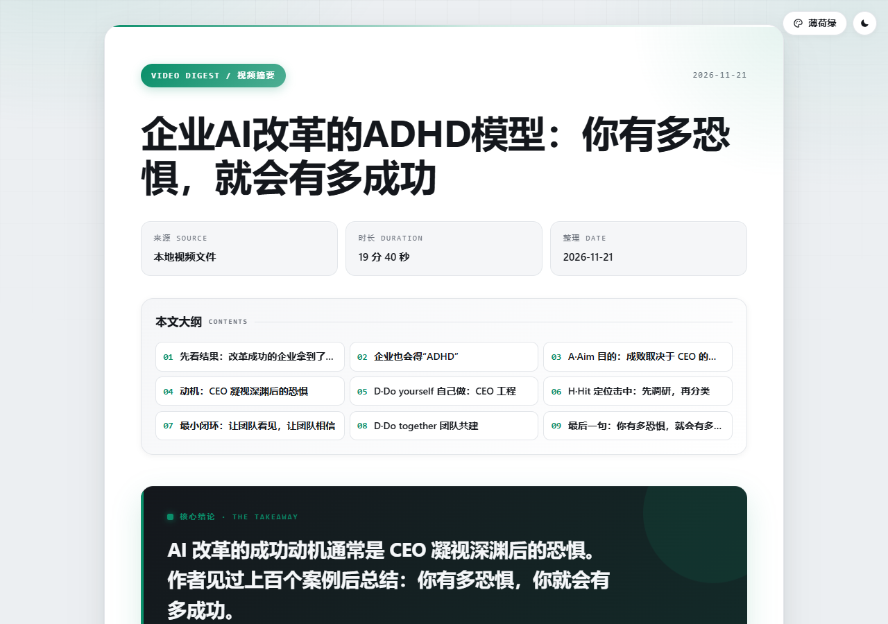
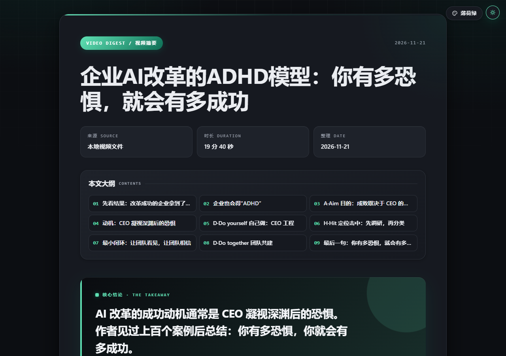
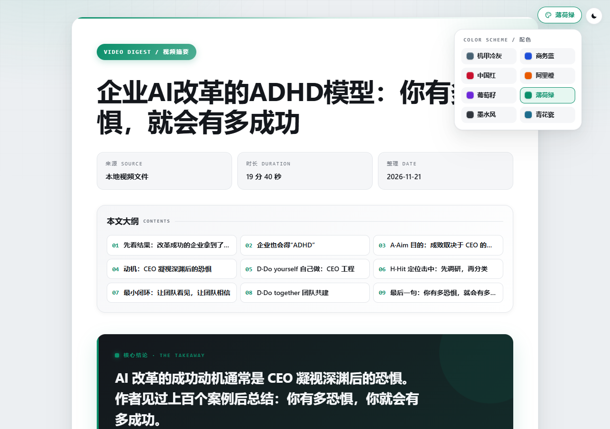
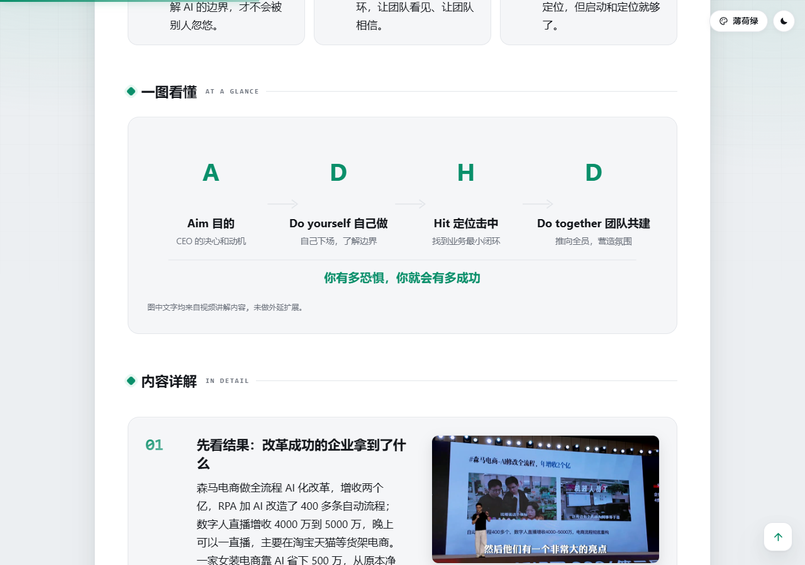
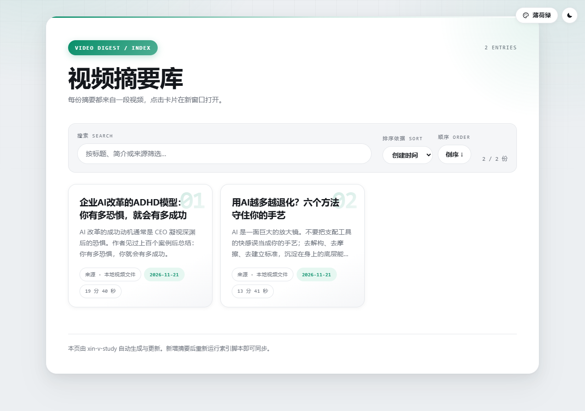

# xin-v-study

Turn a explainer video into a rich, single-page HTML digest.

[中文](README.md) · Python 3.8+ · Agent Skill · Self-contained HTML output



---

## What it does

You watch an explainer video and want something you can skim later — not a transcript, not a review, but a clear account of what the video actually said. This skill transcribes the narration, strips filler words, distills the content into a core takeaway, key points, and section-by-section detail, then illustrates it with real frames pulled from the video. The result is a single HTML file that opens offline.

**The hard rule is fidelity**: nothing the video did not say goes in, and every image is a real frame from the source.

## Features

- **Faithful summaries** — noise removal and distillation only. No added background, no speculation, no filling in gaps for the speaker. Output stays at 20–35% of the transcript.
- **Real stills** — frames are sampled evenly, read one by one, and only those that actually match a section are kept. Captions carry video timestamps. No generated illustrations.
- **Single-file output** — CSS and JS are inline, images are base64. Works offline; copy one file and it still opens.
- **8 color schemes × light/dark** — Mecha Grey, Business Blue, China Red, Ali Orange, Grape, Mint, Ink, Blue-and-White Porcelain. Mint is the default; switch from the top-right, with the choice shared across pages.
- **Outline navigation** — the digest builds a chapter outline automatically, jumps on click, highlights the current chapter on scroll, and has a back-to-top button and scroll progress bar.
- **Knowledge mind map** — a radial map is generated automatically from chapter titles, mapped one-to-one to the body; no manual drawing needed. Use an optional `data-mind` short label when a title is too long.
- **Card index** — every run rebuilds `_list.html` with search, sort by date or name, and new-tab opening.
- **Flexible input** — local video files, direct media URLs, and platform pages such as Bilibili or YouTube.

## Installation

Pick whichever fits your setup.

### Option 1: CLI / skill marketplace (recommended)

Install straight from the repository with the [`skills` CLI](https://github.com/vercel-labs/skills), which targets 40+ tools including Claude Code, Cursor, and Codex:

```bash
npx skills add oscar-wang-xin/xin-v-study
```

Install globally, or target a specific agent:

```bash
npx skills add oscar-wang-xin/xin-v-study -g
npx skills add oscar-wang-xin/xin-v-study --agent claude-code
```

List the skills in the repo first, or skip interactive prompts:

```bash
npx skills add oscar-wang-xin/xin-v-study --list
npx skills add oscar-wang-xin/xin-v-study -y
```

> The command is `npx skills` (plural). A full URL works too: `npx skills add https://github.com/oscar-wang-xin/xin-v-study`. Later, use `npx skills update` to upgrade and `npx skills remove xin-v-study` to uninstall.

### Option 2: download the zip and import

Download [`xin-v-study.zip`](xin-v-study.zip) from the repository root and unzip it, then drop the whole `xin-v-study` directory into your tool's skills directory. The archive contains `SKILL.md`, scripts, templates, references, and this document — no machine-specific config.

```bash
unzip xin-v-study.zip -d /path/to/your/skills/
# or select the archive directly in a tool that supports zip import
```

For WorkBuddy, place it under `~/.workbuddy/skills/` and call it with `@skill:xin-v-study` in a new session.

### Option 3: git clone

```bash
git clone https://github.com/oscar-wang-xin/xin-v-study.git
cp -r xin-v-study ~/.workbuddy/skills/
```

To keep the real files where they are and have edits take effect immediately, use a symlink:

```bash
ln -s /path/to/xin-v-study ~/.workbuddy/skills/xin-v-study
```

## Requirements

- Python 3.8+
- Every step is a plain Python command line — **no host-specific tooling required**. WorkBuddy, Claude Code, Cursor, Codex, etc. all work as long as the agent can run commands.
- Dependencies are installed by `scripts/bootstrap.py`: `imageio-ffmpeg` (frame/audio extraction), `yt-dlp` (online downloads), `faster-whisper` (local speech-to-text).
- The ASR model downloads on first use and is cached locally (`small` ≈ 470 MB by default), then works offline. For slow downloads in China, set `HF_ENDPOINT=https://hf-mirror.com`.

## Configure the output directory

Copy the example config and set your own path:

```bash
cp config.example.json config.json
```

```json
{
  "default_output_dir": "/path/to/your/digests"
}
```

Absolute and relative paths both work; relative paths resolve from the project root. `config.json` is gitignored.

**The default is applied only when chosen.** If you hand over a video without saying where to save it, the skill prompts you to pick one of: the configured default directory (shown with its resolved path, recommended), the current working directory, or another path. The default is never applied silently — it is used only if you select it or specify a directory in your request.

## Getting help

Ask "how do I use this", "what can it do", or "how do I change the save directory" and the skill replies with usage guidance without processing any video. The full help text lives in `references/help.md`.

## Usage

Hand it a video in any skill-capable agent tool and say what you want. Example in WorkBuddy:

```text
@skill:xin-v-study summarize this video: /path/to/video.mp4
@skill:xin-v-study turn this link into a visual digest: <video url>
```

In other tools, mount this directory as a skill and say "summarize this video" together with the file path or link (works in Claude Code, Cursor, etc.). You can also just ask for "a video study note" and attach the file or link. If you don't specify a save directory, the skill asks first.

Transcription first checks the current agent host: hosts with a native audio/video-to-text tool (such as WorkBuddy's AudioTranscribe) use it directly for speed; hosts without one automatically fall back to the bundled local script. Both paths produce the same transcript — no tool is mandatory.

## Workflow

| Step | What happens |
|---|---|
| 0 | Check and install dependencies (idempotent) |
| 1 | Resolve a local path, direct URL, or platform page into a local video file |
| 2 | Prefer the host's native transcription (e.g. WorkBuddy's AudioTranscribe); fall back to `scripts/transcribe.py` when unavailable |
| 3 | Sample frames evenly, read them, keep only those matching a section |
| 4 | Extract the core takeaway, key points, sections, and title without adding content; the mind map is derived from section titles automatically |
| 5 | Render with `assets/report_template.html`; draw an inline SVG diagram when the video has a clear structure, otherwise drop the block entirely |
| 6 | Run `scripts/update_index.py` to rebuild `_list.html` |

See `references/workflow.md` for detailed standards, login-gated sources, and failure fallbacks.

## Output

```text
output/
├── _list.html                    # card index
├── title-extracted-from-video-1.html
└── title-extracted-from-video-2.html
```

A digest contains: header and outline → dark core-takeaway panel → key points → knowledge mind map → optional at-a-glance diagram → illustrated sections → factual closing note.

## Screenshots

**Dark mode** — the same content, with text and diagrams adapting automatically:



**8 color schemes** — a palette button at top-right; scheme and light/dark combine freely:



**At a glance** — an inline SVG diagram when the video has a clear structure, with all text taken from the transcript:



**Card index** — search, sort, open in a new tab; cards show title, description, source, date, and duration:



## Project structure

```text
xin-v-study/
├── LICENSE                       # MIT License
├── README.md / README_EN.md      # Documentation (ZH / EN)
├── SKILL.md                      # Skill definition and execution flow
├── xin-v-study.zip               # Ready-to-import archive
├── config.example.json           # Example default output config
├── scripts/
│   ├── bootstrap.py              # Dependency check and install
│   ├── transcribe.py             # Local speech-to-text (faster-whisper, no host dependency)
│   ├── download_video.py         # Source resolution and download
│   ├── extract_frames.py         # Even frame sampling + timestamp manifest
│   ├── sanitize.py               # Title to safe filename
│   └── update_index.py           # Rebuild the card index
├── assets/
│   ├── report_template.html      # Digest template
│   ├── index_template.html       # Index template
│   └── screenshots/              # Images used in this document
└── references/
    ├── help.md                   # User-facing help text
    ├── workflow.md               # Detailed workflow and failure handling
    ├── design_guide.md           # Visual spec and pre-flight checklist
    ├── infographic_guide.md      # Diagram rules
    └── mindmap_guide.md          # Knowledge mind map generation rules
```

## Content rules

1. Write only what the video actually says. No additions, no speculation, no speaking for the author.
2. Remove filler and tangents; read like prose while preserving meaning.
3. Verify numbers, names, and conclusions against the transcript. Use conservative wording when unsure.
4. Keep the digest at 20–35% of the original transcript.
5. Lead with one core takeaway, then 3–6 key points, each in a single sentence.
6. Preserve the speaker's own ordering — don't shuffle "first / second / finally".

## Themes

| Scheme | Light accent | Feel |
|---|---|---|
| Mecha Grey | `#486273` | Cool steel, low saturation |
| Business Blue | `#1d4ed8` | Saturated corporate blue |
| China Red | `#c8102e` | True red |
| Ali Orange | `#e85900` | Warm orange |
| Grape | `#6d28d9` | Deep purple |
| Mint | `#0a8f6a` | Teal green, the default |
| Ink | `#30353c` | Monochrome |
| Porcelain | `#1c6b8c` | Bluish cobalt |

Scheme and light/dark are orthogonal and freely combinable. Choices persist in `localStorage` (`xvs-scheme` / `xvs-theme`) and are shared between the digest and the index. SVG diagrams take colors from CSS variables so they adapt to dark mode.

## Notes

- Transcription prefers the host's native capability (e.g. WorkBuddy's AudioTranscribe), falling back to the local script; the local path downloads an ASR model on first use (a few hundred MB), then works offline.
- For login-gated platforms, follow `references/workflow.md`. Do not hardcode credentials.
- The local script has no hard duration/size limit; only split very long audio into chunks if memory becomes a concern.
- Videos without narration fall back to visual understanding, and the digest states that explicitly.
- Template upgrades do not update existing digests — each output is self-contained. Regenerate them, and regression-check after template edits.
- Image quality depends on the source. Slide decks and hand-drawn explainers work well; videos with many empty shots or fast cuts give poorer frame matches.
- Regenerate the zip after template or documentation changes.

## License

[MIT](LICENSE) — free to use, modify, and distribute with the copyright notice retained. Provided as-is, without warranty.
